<p align="center">
  
</p>

<p align="center">
  <a href="https://github.com/useagenthq/useagent/pulls?q=is%3Apr+author%3Acoolestnick"></a>
  <a href="https://twitter.com/nikkhil_kr"></a>
  <a href="https://linkedin.com/in/nikhil-kumar-918216183"></a>
  <a href="mailto:contact.nikhil2002@gmail.com"></a>
</p>

```ts
const nikhil = {
  building:  ["AI agents", "dApps on Shardeum, Sui and the Internet Computer"],
  shipping:  "open-source UI and reliability fixes to UseAgent",
  learning:  ["agent evaluation", "LLM tooling", "smart contract security"],
  reachMe:   "contact.nikhil2002@gmail.com",
};
```

## 🤖 Open source: UseAgent



[UseAgent](https://github.com/useagenthq/useagent) is an open-source platform where coding agents work in sandboxed computers. What I've shipped there:

| Area | PR | What it does |
|---|---|---|
| 🗂️ **Workspace** | [#406](https://github.com/useagenthq/useagent/pull/406) | Keep the Terminal's shell running when the agent starts a new turn |
| | [#396](https://github.com/useagenthq/useagent/pull/396) | Render markdown documents in the Workspace Rendered view |
| | [#400](https://github.com/useagenthq/useagent/pull/400) | Keep every file in Download all when two files share a name |
| | [#397](https://github.com/useagenthq/useagent/pull/397) | Spin the Files refresh icon only on a manual refresh |
| | [#404](https://github.com/useagenthq/useagent/pull/404) | Fix the artifact archive method and document the quality route |
| ♿ **Accessibility and mobile** | [#393](https://github.com/useagenthq/useagent/pull/393) | Announce replies, stops and approvals to screen readers |
| | [#399](https://github.com/useagenthq/useagent/pull/399) | Make the side panel on phones a proper dialog, with focus kept inside |
| | [#395](https://github.com/useagenthq/useagent/pull/395) | Say what the thread side panels show, in plain words |
| 🛡️ **Agents and approvals** | [#381](https://github.com/useagenthq/useagent/pull/381) | Unify every tool and command approval onto one card |
| | [#132](https://github.com/useagenthq/useagent/pull/132) | Allow GPT-6 Luna, GPT-6 Sol and GPT-6.1 Sol for Codex |
| 📚 **Library** | [#394](https://github.com/useagenthq/useagent/pull/394) | Let people delete skills and playbooks from the library |
| 🚀 **Onboarding** | [#376](https://github.com/useagenthq/useagent/pull/376) | A skippable product tour with a spotlight, keyboard support and model setup steps |
| 🔁 **Reliability** | [#193](https://github.com/useagenthq/useagent/pull/193) | Make the error page's Retry fetch the page again |

**In review:** [#408](https://github.com/useagenthq/useagent/pull/408) asks before closing a Workspace tab with unsaved edits, with Save, Discard and Cancel.

## 🧠 AI and agents

| Project | What it does | Built with |
|---|---|---|
| [AI-wallet-backend](https://github.com/coolestnick/AI-wallet-backend) | Multi-agent crypto research: a selector routes each question to a market research, portfolio or advisor agent, with live web scraping | Python, FastAPI, Gemini, OpenAI, MCP, Firecrawl |
| [magicpin-ai-challenge](https://github.com/coolestnick/magicpin-ai-challenge) | Merchant engagement bot with a reply router, versioned context store and an optional LLM composer, scored by a judge simulator | Python, FastAPI, Pydantic |
| [Difinity](https://github.com/coolestnick/Difinity) | An LLM canister with tool calling, running on the Internet Computer | Motoko, React |
| [ai-image-generator-using-dall-e-3](https://github.com/coolestnick/ai-image-generator-using-dall-e-3) | Image generation from text prompts | OpenAI DALL·E 3, React |

### AI stack, with proof

| Technology | Where I used it |
|---|---|
| Coding agents (Claude Code, Codex) | [UseAgent #132](https://github.com/useagenthq/useagent/pull/132) model support for Codex, [#381](https://github.com/useagenthq/useagent/pull/381) agent approval cards |
| Multi-agent routing | [agents/selector.py](https://github.com/coolestnick/AI-wallet-backend/blob/HEAD/agents/selector.py) |
| Google Gemini | [agents/base.py](https://github.com/coolestnick/AI-wallet-backend/blob/HEAD/agents/base.py) |
| OpenAI API | [pyproject.toml](https://github.com/coolestnick/AI-wallet-backend/blob/HEAD/pyproject.toml), [DALL·E 3 app](https://github.com/coolestnick/ai-image-generator-using-dall-e-3/blob/HEAD/package.json) |
| Model Context Protocol (MCP) | [pyproject.toml](https://github.com/coolestnick/AI-wallet-backend/blob/HEAD/pyproject.toml) |
| Web scraping for agents (Firecrawl) | [agents/firecrawl_research.py](https://github.com/coolestnick/AI-wallet-backend/blob/HEAD/agents/firecrawl_research.py) |
| LLM tool calling on-chain | [Difinity](https://github.com/coolestnick/Difinity) |
| Conversational bot design | [bot/README.md](https://github.com/coolestnick/magicpin-ai-challenge/blob/HEAD/bot/README.md) |

## ⛓️ Blockchain projects

| Project | What it does | Stack |
|---|---|---|
| [gasless-Airdrop-Plarform](https://github.com/coolestnick/gasless-Airdrop-Plarform) | Token airdrop claims where a backend wallet pays the gas | JavaScript |
| [Shard-Talk](https://github.com/coolestnick/Shard-Talk) | Chat dApp with every message stored on-chain on Shardeum | TypeScript |
| [ShardeumQuest](https://github.com/coolestnick/ShardeumQuest) | Gamified DeFi learning with achievement NFTs | JavaScript |
| [SNS-Shardeum-Naming-Service](https://github.com/coolestnick/SNS-Shardeum-Naming-Service) | Naming service for Shardeum addresses | JavaScript |
| [HYPE-NOTIFY](https://github.com/coolestnick/HYPE-NOTIFY) | Real-time alerts and portfolio monitoring for Hyperliquid traders | TypeScript |
| [defraud](https://github.com/coolestnick/defraud) | Reporting fraudulent transactions on Sui | Move |
| [TIME-CAPSULE](https://github.com/coolestnick/TIME-CAPSULE) | Content locked until an unlock date, on the Internet Computer | Rust |

### Web3 stack, with proof

| Technology | Where I used it |
|---|---|
| Solidity, Hardhat, OpenZeppelin | [ShardeumQuest](https://github.com/coolestnick/ShardeumQuest/blob/HEAD/package.json) |
| ethers.js, gasless relaying | [gasless-Airdrop-Plarform](https://github.com/coolestnick/gasless-Airdrop-Plarform) |
| wagmi, viem, RainbowKit | [Shard-Talk](https://github.com/coolestnick/Shard-Talk/blob/HEAD/package.json) |
| Move on Sui | [defraud](https://github.com/coolestnick/defraud) |
| Rust and Motoko on the Internet Computer | [TIME-CAPSULE](https://github.com/coolestnick/TIME-CAPSULE), [Difinity](https://github.com/coolestnick/Difinity) |

## 🛠️ Languages and tools

<p align="left">


</p>
